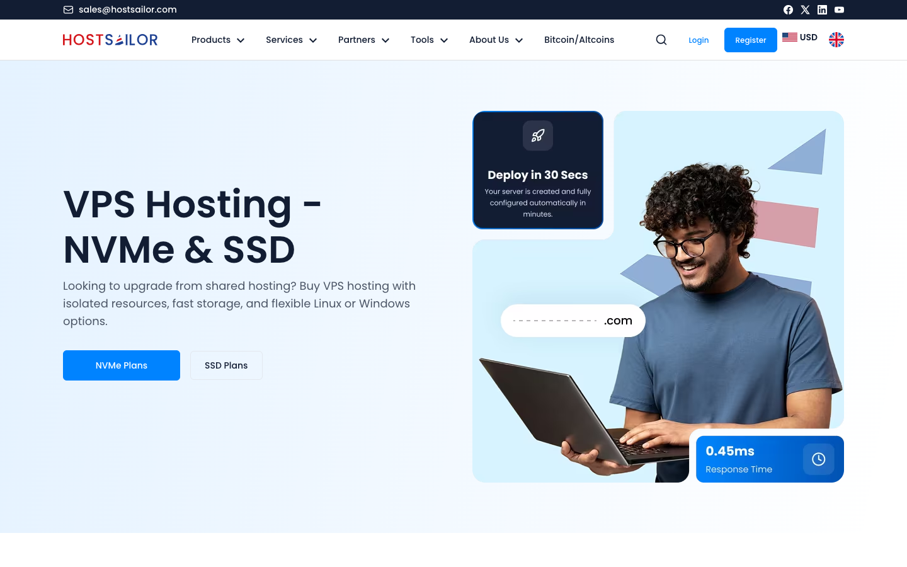
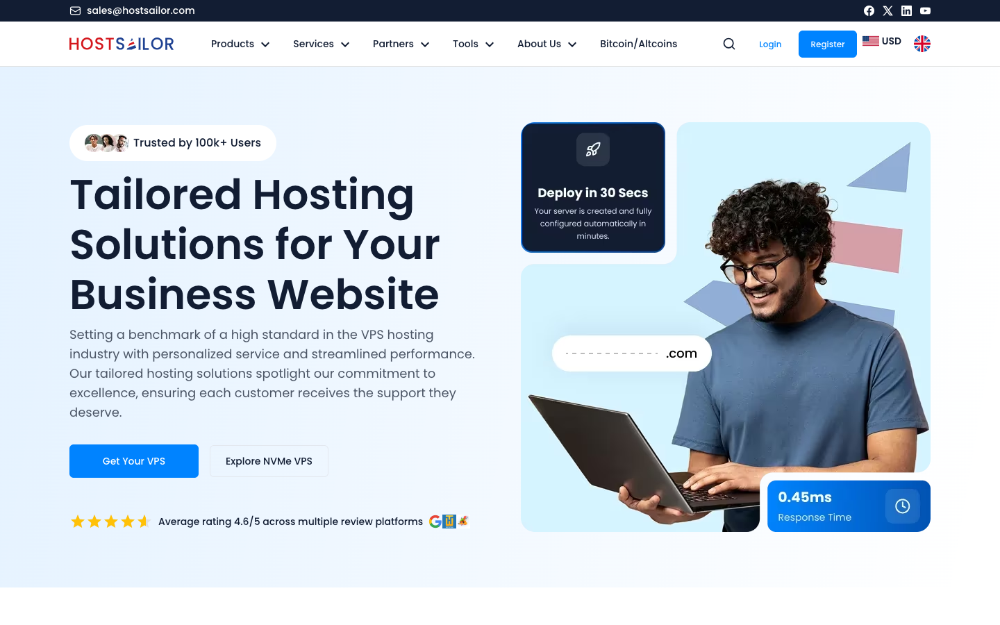
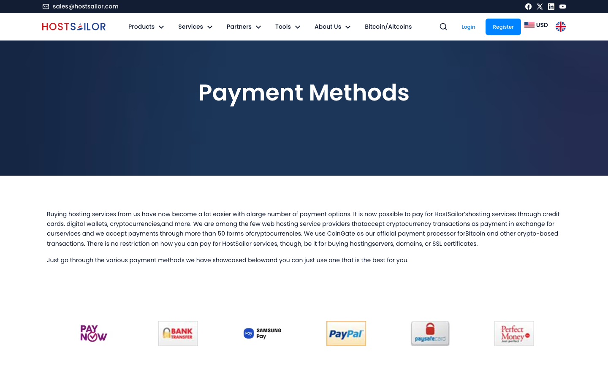

# HostSailor VPS 评测 2026：$1.95/月起，NVMe、SSD 与存储 VPS 怎么选

HostSailor 最吸引人的地方不是只有一个“便宜 VPS”，而是把三种预算路线分开：**NVMe VPS $4.99/月起、SSD KVM $2.99/月、HDD Storage VPS $1.95/月起**。建站选 NVMe，普通小服务选 SSD，需要大容量文件与备份则看 Storage VPS。

**一句话推荐：想用较低月费购买欧洲或美国 VPS，并且希望信用卡、PayPal、银行转账和加密货币都能付款，HostSailor 值得比较。**

[查看 HostSailor VPS 套餐](https://clients.hostsailor.com/aff.php?aff=1529)

## HostSailor 与 RackNerd、Vultr 怎么选？

| 需求 | 更适合的方向 |
|---|---|
| 最低年付总额、轻量 Linux 长期在线 | RackNerd 类年付 VPS |
| 按小时开关机、云 API 和大量区域 | Vultr 类云平台 |
| 月付低价、NVMe/SSD/Storage 三种路线 | HostSailor |
| Bitcoin 或多种加密货币付款 | HostSailor |

HostSailor 适合知道自己要哪类磁盘和用途的人。它不是让用户做复杂配置题，而是先回答：网站要速度、普通服务要性价比，还是备份要容量？

## 三类 VPS 直接这样选

### NVMe VPS：网站与高频读写

公开页显示 NVMe VPS 从 **$4.99/月** 起，荷兰机房，AMD EPYC、DDR5、NVMe + RAID 10，并支持 Linux、Windows、Solaris 和 BSD。适合 WordPress、WooCommerce、数据库、小型 SaaS、Docker 和开发环境。

### SSD KVM VPS：普通服务性价比

SSD KVM 公开价 **$2.99/月**，美国机房，Intel Xeon、DDR4、SSD + RAID 10。适合个人网站、监控、Bot、代理后端、测试环境和轻量 API。

### HDD Storage VPS：备份与归档

Storage VPS 从 **$1.95/月** 起，重点是低成本容量，适合异地备份、日志、归档和下载中转。它不应被当成高 IOPS 数据库服务器。

[进入 HostSailor 购买入口](https://clients.hostsailor.com/aff.php?aff=1529)

## 荷兰还是美国机房？

荷兰 NVMe 更适合欧洲网站和需要 NVMe 的应用；美国 SSD 更适合北美访问、普通建站和低成本长期服务。选择机房时看主要访客和上游 API 在哪里，不要只按自己的物理位置决定。

HostSailor 首页强调快速部署与多种托管产品，但 VPS 仍是自主管理服务器：系统安全、软件安装、备份和故障恢复由用户负责。

## 支付方式非常丰富

HostSailor 公开付款页列出信用卡、数字钱包、银行转账、PayPal、Paysafecard、Perfect Money 等方式，并通过 CoinGate 支持 Bitcoin 及 50 多种加密货币。

对没有单一国际信用卡渠道、需要 PayPal 或加密货币付款的用户，这比只支持银行卡的 VPS 商家方便。实际可用渠道仍以订单页显示为准。

## 购买前看这五项

1. NVMe、SSD 还是 HDD Storage，不要只看最低价格；
2. 荷兰或美国机房是否接近用户；
3. Linux、Windows 或其他系统是否适配应用；
4. 月流量、端口与额外 IP 费用；
5. 当前取消、退款和加密货币付款条款。

VPS 开通后属于即时交付服务，不要默认所有付款方式都能无条件退款。第一次购买从最低满足需求的月付配置开始，先部署真实应用再升级。

## 推荐购买方案

- **WordPress / Docker / 数据库：**NVMe VPS；
- **监控 / Bot / 小网站 / 测试：**SSD KVM；
- **备份 / 日志 / 文件归档：**HDD Storage VPS；
- **必须 Windows：**确认目标产品明确支持 Windows 后再下单。

## 最终建议

HostSailor 的优势是把低价 VPS 做成三条清晰路线。不要被 $1.95 的最低数字带偏：存储任务选 Storage，普通服务选 SSD，网站与高频读写选 NVMe。选对产品线，比单纯追求最低价更重要。

[查看 HostSailor 当前 VPS 套餐](https://clients.hostsailor.com/aff.php?aff=1529)

## FAQ

### HostSailor 最便宜的 VPS 是多少？
公开页面列出 HDD Storage VPS 从 $1.95/月起；普通 SSD KVM 为 $2.99/月，NVMe 从 $4.99/月起。

### HostSailor 支持 Bitcoin 吗？
支持。公开付款页说明通过 CoinGate 接受 Bitcoin 和 50 多种加密货币。

### HostSailor 适合建站吗？
适合。动态网站和数据库优先看 NVMe；低流量普通网站可比较 SSD KVM。
